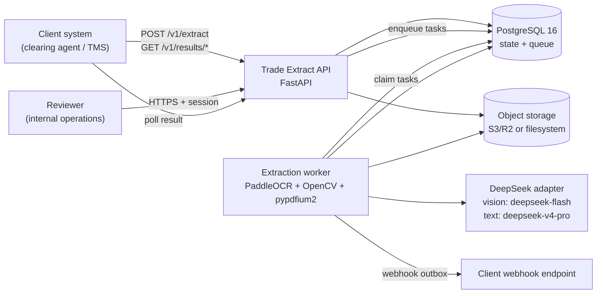
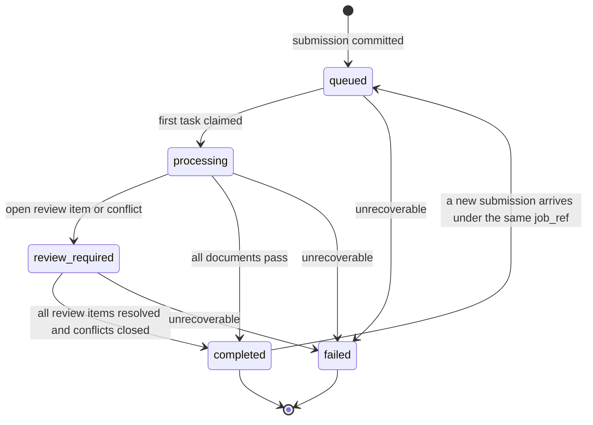

# 01 — Architecture

## 1. Goal

Build the smallest production-ready system that can accept a caller-grouped set of trade
documents, split every file into document segments, extract stated values with provenance, run
deterministic checks, report disagreements between documents, and route uncertain output to human
review — without ever inventing a value or silently resolving a conflict.

The architecture optimises for three things, in order:

1. **Auditability.** Every value can be traced to a page and a box. Every decision records the
   policy version that produced it.
2. **Refusal over guessing.** Unreadable pages, failed schemas and reader disagreement are explicit
   outcomes, not confidence scores.
3. **Operability for a small team.** One language, one database, one queue, one storage interface,
   and a review UI that needs no frontend build pipeline.

## 2. System context



The API never imports OCR, OpenCV or pypdfium2. The worker is the only image that contains them.
The review UI is served by the API process; it has no separate deployment in v1.

## 3. Runtime topology

| Process | Image | Responsibility | Scaling unit |
|---|---|---|---|
| `api` | `Dockerfile.api` (slim) | Public JSON API, API-key auth, upload validation, review UI, webhook management, health. | Stateless; scale behind a load balancer. |
| `worker` | `Dockerfile.worker` (OCR image) | File preparation, conditioning, segmentation, reader routing, extraction, checks, conflicts, decisions. | Scale replicas; one OCR task at a time per process by default. |
| `worker-maintenance` | same worker image, different command | Webhook delivery, retention sweeps, stale-task recovery, account exports. | Single instance or leader-elected; safe to run more than one with `SKIP LOCKED`. |
| `postgres` | `postgres:16` | Durable state, job queue, audit, provider-call ledger. | Vertical first; read replicas only when reporting demands it. |
| object storage | external | Source files, page images, thumbnails, crops. | Backend-defined. |

`web` is intentionally absent. The review UI is a router and a template directory inside `api`.
If a customer-facing portal is ever built, it is a separate application and does not change this
design.

### Why one Python codebase

PaddleOCR is Python. The alternative — a TypeScript API calling a Python OCR service — buys nicer
API ergonomics and costs a second language, a second dependency tree, a second deploy path and an
internal RPC contract. For a small team that is a bad trade. PaddleOCR is confined to the worker
image, so the API stays slim without a second language.

### Why Postgres is also the queue

A job is durable, takes minutes, and must survive a restart. `SELECT … FOR UPDATE SKIP LOCKED` over
a `job_tasks` table gives durable claiming, retries, visibility timeouts and dead-lettering in a few
hundred lines, with one datastore and one transaction boundary that covers both the task and its
result. Redis and Celery add a second datastore and a configuration surface that earns nothing at
v1 volume. Revisit when throughput or fan-out justifies it.

## 4. Component responsibilities

| Component | Owns | Must not do |
|---|---|---|
| `api.routes` | HTTP parsing, auth, limits, response shaping, OpenAPI. | Touch OCR, model prompts, or raw document bytes after storage. |
| `services.ingest` | Stream-to-temp validation, magic-byte sniffing, storage put, job/submission/file rows, task enqueue. | Process pages synchronously. |
| `services.queue` | Claim, heartbeat, retry, dead-letter, stale-task recovery. | Contain domain logic. |
| `services.pipeline` | Orchestrate prepare → segment → extract → validate → decide → finalize. | Know provider wire formats. |
| `services.conditioning` | Orientation, deskew, crop, DPI normalisation, denoise, legibility score. | Call a model. |
| `services.segmentation` | Always-on page classification and segment grouping. | Infer job grouping or match documents across jobs. |
| `services.readers` | Text layer, PaddleOCR and vision behind one interface; per-page routing. | Let one reader be privileged by construction. |
| `services.extraction` | Merge candidates, resolve field paths, validate and repair schema output, write provenance. | Emit a field without provenance. |
| `services.validation` | Deterministic checks and human-readable reasons. | Emit computed values as data. |
| `services.conflicts` | Canonical-key comparison across a job. | Choose a winner. |
| `services.decisions` | Apply the versioned policy; produce pass/review and reasons. | Use model confidence as a gate. |
| `services.review` | Review items, resolutions, labelled records. | Merge extraction and conflict tracks. |
| `services.trust` | Trust records per client/supplier/type/fingerprint. | Auto-promote in v1. |
| `services.retention` | Purge objects after terminal; retain extraction records. | Delete extraction records with files. |
| `providers` | Translate domain requests to DeepSeek or mock responses. | Leak provider types into the domain. |
| `db` | SQLAlchemy models, repositories, migrations. | Contain business decisions. |

Dependency direction: `api` and `workers` → `services` → `domain` / `schemas` / `db` / `providers`.
`domain` depends on nothing but the standard library and Pydantic. `providers` depends on `domain`
types, never the reverse.

## 5. Domain model

```text
Job (logical accumulator, keyed by client + job_ref)
 └── Submission (one POST /v1/extract, one result_id)
      └── File (uploaded container)
           └── Page (atom: image, text layer, legibility)
                └── Segment (contiguous page range + document type)
                     └── Document (extraction record)
                          ├── FieldValue (stated value + provenance)
                          ├── Check (deterministic outcome)
                          └── Decision (pass / review / unreadable / failed)

Job
 ├── Conflict (canonical field + every disagreeing source document)
 ├── ReviewItem (exactly one track: extraction or conflict)
 ├── Decision (job-level)
 └── TrustRecord (client × supplier × type × template fingerprint)
```

A file is a container. A page is the atom. A segment is the unit of extraction. A job is the unit
of reconciliation. The platform never merges documents into a single JSON blob; each document keeps
its own output.

### Why segments, not documents, own page ranges

A PDF can contain a bill of lading, an invoice and a packing list. If the document owned pages, a
misclassification would duplicate or lose pages. The segment owns a non-overlapping page range;
the database enforces that ranges cannot overlap within a file. Every page belongs to exactly one
segment, including `unknown` pages, so coverage is auditable.

## 6. End-to-end pipeline

```mermaid
sequenceDiagram
    autonumber
    participant C as Client
    participant A as API
    participant P as Postgres
    participant S as Object storage
    participant W as Worker
    participant M as Model adapter
    participant H as Client webhook

    C->>A: POST /v1/extract (multipart, job_ref, files)
    A->>A: auth, size/type/page limits, multi-shipment guard
    A->>P: upsert job, create submission + files + tasks
    A->>S: put source files
    A-->>C: 202 {result_id, job_id, status_url}
    W->>P: claim prepare_file (SKIP LOCKED)
    W->>S: get source
    W->>W: rasterise, condition, score legibility
    W->>P: write pages; mark unreadable pages
    W->>W: always-on segmentation (inline in prepare_file)
    W->>P: write segments; enqueue extract_segment per segment
    W->>P: claim extract_segment
    W->>M: text layer / PaddleOCR / vision per routing policy
    M-->>W: field candidates with boxes
    W->>W: merge, validate schema, repair, write field_values
    W->>P: write checks, conflicts, decisions, review items
    W->>P: finalize submission + webhook outbox
    W->>H: signed webhook event
    C->>A: GET /v1/results/{result_id}
    A-->>C: per-document JSON + conflicts + decision
```

### 6.1 Ingestion

The API streams each upload to a temporary file, enforcing limits **before** writing to object
storage:

- 1–20 documents per submission (`MAX_DOCUMENTS_PER_GROUP`).
- 25 MiB per file (`MAX_FILE_BYTES`).
- 500 pages per file; 2,000 pages per submission.
- Allowed types: PDF, JPEG, PNG, WebP, TIFF. Type is detected from magic bytes, never from the
  declared `Content-Type`.
- Encrypted, zero-page, malformed or macro-bearing files are rejected with a named error.
- The multi-shipment guard looks for **positive evidence** of two or more distinct bill-of-lading
  numbers in one submission. On positive evidence it rejects with `422 multi_shipment_container`,
  names the count, and instructs the caller to split. Ambiguous evidence proceeds to review; the
  platform does not refuse on a guess.

Only after validation does the API write the file and create rows. A rejected request leaves no
stored object and no job.

### 6.2 Preparation

The worker:

1. Parses the container with pypdfium2.
2. Rasterises each page at 300 DPI (configurable). Thumbnails are capped by their long edge
   (512 px by default), not rendered as a second near-full-size raster.
3. Detects and corrects orientation, skew, crop, DPI and noise with OpenCV.
4. Computes the provisional `image-quality-v1` image heuristic from measured contrast, Laplacian variance, ink fraction, retained document dimensions and line skew. OCR confidence is unavailable and is not used.
5. Marks a page `unreadable` with a reason when correction does not save it. Unreadable pages are
   never sent to a model.

Page images, thumbnails and crops are stored; the source file remains untouched.

### 6.3 Segmentation

Segmentation always runs, never conditionally. A cheap deterministic classifier scores each page
against the document-type lexicon using the page's embedded text only. A page that ties, falls below
the configured confidence floor, or has no text is `unknown`. Pages are grouped into contiguous
segments; every page is covered exactly once. The vision fallback for below-threshold or unreadable
pages arrives with reader routing (6.4); this stage makes no model calls.

The output is a list of `(page_start, page_end, document_type, confidence, fingerprint)`. An
`unknown` page after a confident page inherits that page's type as a continuation and merges into its
segment; `unknown` pages before any confident page stay `unknown`. `unknown` segments are routed to
review only once checks and decisions exist. Segmentation never infers a job relationship; it only
splits a file.

### 6.4 Reader routing

Three readers sit behind one interface:

| Reader | Strength | Limitation |
|---|---|---|
| Embedded text layer | Exact characters on digital PDFs. | Absent on scans; can be stale or hidden. |
| PaddleOCR (PP-Structure) | Deterministic text and table structure. | Weak on stamps, handwriting, rotated photos. |
| Vision model (`deepseek-flash`) | Semantics, stamps, handwriting, layout. | 1024 tokens/image; whole pages are downscaled. |

The per-page routing policy chooses which readers run:

- **Digital, clean text layer** → text layer alone; structural OCR and native vision crops for tables.
- **Clean flat scan** → PaddleOCR + vision; compare.
- **Photographed, skewed or stamped** → vision primary, PaddleOCR secondary; dense regions as
  native-resolution crops.
- **Table-heavy** → PaddleOCR PP-Structure for structure, vision for headers and exceptions.
- **Unreadable** → no reader; explicit unreadable outcome.

The policy is data, not a hard-coded branch. No reader is privileged by the merge step: a single
reader's value is marked `single_reader`, and disagreement is a first-class signal.

### 6.5 Extraction and repair

For each segment, the worker asks the routed readers for field candidates. Each candidate carries
field path, stated value, raw text, page index, bounding box, reader, model and confidence.

The merge step:

- Groups candidates by canonical field path.
- Marks `unanimous`, `majority`, `single_reader` or `disputed`.
- Selects an emitted value only when the policy allows it; a disputed critical field still emits
  the selected value but is flagged and blocks pass.
- Writes `field_values` and keeps every candidate in `field_candidates` for review.

The merged JSON is validated against the document-type Pydantic schema. Provider JSON mode
guarantees valid JSON, not schema adherence, so a validate-and-repair loop is part of the pipeline.
Repair is capped at two attempts and uses the schema errors plus the original page evidence. If
validation still fails, the document becomes `extraction_failed` with a review item; no partial
guess is promoted to a value.

### 6.6 Checks

Checks are deterministic and independent of the model:

- Required fields present.
- Arithmetic identities (commercial invoice full set; advisory elsewhere).
- Enum validity (currency, incoterm, unit codes).
- Date ordering.
- Container check digits (ISO 6346).
- HS code structure.
- Table completeness (stated rows vs extracted rows; no silent truncation).
- Reader agreement on critical fields.
- Cross-document equality and referential integrity.

Every check produces a code, status, field path, expected value, actual value, severity and a
human-readable message. Computed values are never written into the document's emitted fields.

### 6.7 Decision

The decision engine applies the active, versioned policy:

- **Commercial invoice** may pass when all blocking checks pass, required fields are present, no
  critical reader disagreement exists, no page is unreadable, and the job has no open conflict.
- **The other types** route to full review in v1; their checks are advisory and still recorded.
- **Any open conflict** in the job forces a review decision on the job, on the conflict track.
- **Any extraction failure or unreadable page** creates an extraction review item.
- **Trust state** is recorded but does not reduce review depth in v1. The policy has the dial; it
  is off.

Model confidence is never an input to the gate. It may order the review queue.

Every decision stores `policy_id`, `policy_version`, reason codes and a human-readable reason.

### 6.8 Conflicts

A canonical-key map translates document-specific field paths into shared keys, for example
`bill_of_lading.gross_weight` and `packing_list.gross_weight` both map to
`shipment.gross_weight_kg`.

For each canonical key with at least two stated values in the job:

- Normalize only for comparison (numeric tolerance, date, case, whitespace, set semantics for
  containers).
- If the normalized values differ, create one conflict naming the key and every disagreeing
  document, with each document's own stated value and provenance.
- Never choose a winner, never edit a document, never close the conflict automatically.

A later submission under the same `job_ref` recomputes conflicts across the whole job. New
documents can add sources to an existing conflict or create a new one.

### 6.9 Review and trust

Reviewers see two queues that are never merged:

- **Extraction review** — the platform misread something. Our fix.
- **Conflict review** — the papers genuinely disagree. The client's business call.

Every resolution is a labelled record: field, prior value, corrected-or-confirmed outcome, reason,
reviewer, timestamp. Conflict resolutions record the client's decision (accept a document's value,
waive, or notify) but do not mutate either document's stated value.

Trust records exist per `(client, supplier, document_type, template_fingerprint)`. Unseen templates
start at full review; a human correction demotes the record. v1 never auto-promotes.

## 7. State machines

### Job



`terminal_at` is set on `completed` or `failed`, but only when no review item or conflict remains
open. `review_required` is not terminal, so the six-hour clock has not started.

A completed job is not sealed. A later submission under the same `job_ref` reopens it: status returns
to `queued`, `terminal_at` and `terminal_reason` are cleared, and conflicts are recomputed against
the retained extraction records. A failed job rejects further submissions with `409 job_failed` and
instructs the caller to use a new `job_ref`; a failed job is not a useful accumulator.

### Submission

`queued → processing → completed | failed`. A submission may be completed while the job is still
`review_required`; the result reports the review state.

### Document

`queued → processing → extracted → review_required → resolved`, with `unreadable` and `failed` as
terminal outcomes for that document. A document is never silently skipped.

### Task

`queued → running → succeeded | failed → queued (retry) | dead`. A stale `running` task is
recovered by the visibility timeout.

## 8. Security architecture

- **API auth:** bearer API key, stored only as an HMAC-SHA256 hash with a server pepper. Key prefix
  enables lookup without a full-table scan. Scopes: `extract:write`, `results:read`,
  `account:read`.
- **Review UI auth:** username + scrypt password, signed session cookie (`HttpOnly`, `Secure`,
  `SameSite=Lax`), CSRF token on every unsafe request, 8-hour absolute / 30-minute idle timeout,
  session epoch for revocation.
- **Tenant isolation:** every query is scoped by `client_id`; storage keys are prefixed by client.
  IDs are opaque but never trusted for authorization.
- **Upload safety:** magic-byte sniffing, size and page caps, parser timeouts, no shell execution,
  worker runs as a non-root user, no network egress from the worker except the provider and
  storage.
- **Webhook safety:** HTTPS only in production, HMAC signature over timestamp + raw body,
  five-minute replay window, no redirects, private/link-local addresses blocked (SSRF).
- **Content hygiene:** logs, traces, metrics and error reports carry hashes, IDs, timings, model
  versions and outcomes — never page images, document text, prompt payloads or field values.
- **Secrets:** environment or managed secret store only; no secrets in images or committed Compose
  files. Webhook signing secrets are encrypted at rest with an application key.
- **Retention:** files die six hours after terminal; extraction records live for the life of the
  account plus ninety days after termination, exportable and deletable on request.

## 9. Observability

| Signal | Where | Example |
|---|---|---|
| Structured JSON logs | stdout | `request_id`, `client_id`, `job_id`, `document_id`, `task_id`, `event`, `duration_ms`, `status`, `error_code`. |
| Provider call ledger | Postgres `provider_calls` | model, prompt hash, tokens, cached tokens, latency, status. No content. |
| Metrics | `/metrics` (Prometheus format) | request rate, 5xx rate, queue depth, oldest task age, provider errors, webhook backlog, retention overdue. |
| Health | `/v1/health`, `/v1/health/ready` | liveness; readiness checks DB and storage. |
| Audit | `audit_events` | who resolved what, when, from which route. |

The most important alert is not API latency. It is **retention overdue**: objects older than policy
mean the privacy promise is false. A purge that fails quietly is worse than a long policy because
nobody expects it.

## 10. Scaling and failure behaviour

| Failure | Behaviour |
|---|---|
| Provider timeout / 429 | Retry with jitter up to the task limit; then `extraction_failed` review item. Never fabricate. |
| PaddleOCR crash | Reader marked unavailable; other readers continue; check `ocr_unavailable` routes to review. |
| Storage 5xx | Task retries; no state transition until the object is durable. |
| Worker crash mid-task | Visibility timeout requeues; handlers are idempotent. |
| DB unavailable | API returns `503` with `Retry-After`; workers back off; no partial commits. |
| Webhook failure | Exponential backoff, dead-letter after eight attempts, visible in the UI. |
| Stale task | Reaper returns `running` tasks past the visibility timeout to `queued`. |
| Queue backlog | Scale worker replicas; alert on oldest queued task age, not just depth. |
| S3 versioning | Non-current versions expire on the same schedule as the purge, or the purge is a fiction. |

Horizontal scaling is stateless for `api`; `worker` scales by replica count. Postgres is the first
bottleneck; the queue query uses a partial index and short transactions. Long model calls never
hold a database transaction open.

## 11. Non-functional targets

| Concern | Target |
|---|---|
| API availability | 99.9% monthly. |
| `POST /v1/extract` p95 | < 500 ms after upload completes (upload time excluded). |
| Single-page invoice p95 | < 60 s from acceptance to result. |
| 20-document / 100-page group p95 | < 8 min. |
| Webhook p95 | < 30 s after result completion. |
| Idempotency | Repeating a submission returns the same result; no duplicate documents. |
| Provenance coverage | 100% of emitted leaf fields. |
| Silent truncation | Zero; explicit `unresolved_rows` or `truncated: true` instead. |
| Retention | 100% of eligible objects purged within 30 minutes of the six-hour deadline; alert otherwise. |

## 12. What is intentionally simple

- No microservices. Two images, one codebase.
- No event bus. Postgres tasks and an outbox table.
- No SPA. Jinja2 fragments and a small vanilla JS file.
- No vector database or RAG. The schema is fixed; the model reads pages.
- No per-client prompts or per-client code. The schema is invariant across layouts.
- No automatic trust promotion, no ERP posting, no duty computation, no email ingestion.
- No GPU requirement. CPU is the default; GPU is an optional worker profile.

These are not gaps. They are choices that keep the system auditable and shippable. Each is revisited
only when a measured constraint earns the complexity.


### Implemented page conditioning (story 5)

Every prepared page is conditioned before derivative storage. Pillow captures image EXIF before
JPEG encoding; all eight supported EXIF layouts map source pixels to corrected pixels. PDFium has
already applied PDF rotation, so conditioning never rotates it again. Deterministic horizontal line
evidence supports small deskew (up to 12 degrees); geometry alone cannot establish upright versus
upside-down text. That uncertainty is persisted. Strong sideways line evidence without a source
hint is refused as `ambiguous_orientation`, rather than choosing a rotation direction.

Perspective/border correction requires a unique convex bright sheet covering 50-95% of an image,
with a uniform dark surround. Every discarded native pixel is checked, including pixels adjacent to the sheet; a small
margin is retained in the derivative. Variable or marked surrounds that fail that check remain
intact and receive an uncertain-border refusal. Uncertain content is never cropped. Deskew expands the canvas instead of clipping corners. Known excess DPI may be
reduced toward PAGE_RENDER_DPI only while retaining the useful detail floor; pages are never upscaled. Low-strength bilateral denoise preserves
colour and edges, with no component removal, stamp removal or binarization.

The provisional defaults refuse retained document short edges below 600 px, 0.1 to 99.9 percentile contrast below
25, Laplacian variance below 15, ink fraction below 0.001 or above 0.8, unsupported orientation and
excessive skew. Metrics run at at most 1600 px on the long edge; decoded/derived pages are capped
at 40 million pixels. `CONDITIONING_*` settings validate budgets and quality thresholds; effective
values are persisted alongside each result. The score is the capped minimum ratio of contrast,
blur and source size to their thresholds. It neither approves documents nor proves semantic
readability. Defaults remain provisional until labelled-document evaluation in story 7.

Page conditioning JSON retains operations, measurements, refusal reasons, version, effective policy,
and normalized character boxes. Coordinates refer to the conditioned image, top-left, normalized
0 to 1. A pair of 3 by 3 homographies maps pixel-edge points from the rendered source image to conditioned
image and back, including perspective. Point/polygon mapping is reversible; an axis-aligned box
maps to the enclosing box of its four transformed corners, so repeated box enclosing can expand.
The original uploaded file and page/segment identities remain unchanged.

Vision requires explicit current-version conditioned evidence and a transform, including direct
reader calls and repairs. Every reader skips unreadable pages. A mixed segment retains readable
candidates for diagnosis but cannot promote an extracted document when any page is unreadable.
Preparation remains atomic and idempotent; this story does not activate document lifecycle tasks.


Conditioning follow-up: TIFF orientation is consumed by Pillow during decode and is not applied a
second time. Perspective sampling uses a conservative bound on the homography Jacobian over the
retained sheet; output dimensions are reduced until local magnification respects
CONDITIONING_MAX_ENLARGEMENT. Rotation canvas padding is excluded from that sampling bound.
Retained sheet dimensions and final derivative dimensions both constrain the detail floor, so
photo surrounds and DPI metadata cannot rescue or create resolution. Dominant vertical line
evidence is compared against horizontal line strength; conflicting significant skew is an explicit
unresolved-skew refusal. Supplied homographies must be finite, nonsingular, mutually inverse and
free of an image-crossing projective horizon, and conditioned dimensions must match image metadata
before direct vision dispatch or repair. Mixed-segment exits retain page refusal reasons alongside
provider or validation diagnostics, including no-evidence outcomes.


## Story 6 implementation: routing and independent tables

`services.extraction.extract` remains a reusable service; worker lifecycle activation is story 8.
`PageFeatures` carries caller-owned positive evidence. Good aligned text plus an explicit absence
of dense tables selects text alone. Explicit clean flat scans select OCR and vision. Photographs,
skew, stamps, handwriting and unknown visual evidence select vision as primary; marked pages use
OCR only for supporting structure. Unreadable pages reach no reader. Route reasons, configured
reader availability and effective version/thresholds accompany every service outcome. Defaults are
provisional pending story 7. A missing feature is unknown, never evidence of an unmarked scan.

`PaddleReader` lazily initializes a process-cached, serialized CPU PPStructureV3 engine. It returns
validated OCR spans separately from table-structure status, preserving usable scalar evidence when
structure fails. Cached evidence must match page/version and budgets. Pixels, spans, regions, rows,
cells and HTML bytes are bounded; malformed geometry and every nonfinite polygon vertex are
rejected. OCR confidence remains diagnostic. Every emitted Paddle field must match an observed
text span and its exact normalized conditioned-page rectangle; all semantic reasoning stays behind
the provider adapter and schema/repair loop. Explicit reader lists never initialize excluded OCR.

Explicit `thead`/`th` header rows are excluded from data inventory. Merged cells, overlapping grids,
ambiguous rows and unknown semantic correspondence prevent unsupported completeness. Semantic
correspondence can be established from validated provider row citations contained in physical rows;
a bounded second pass then uses the resulting global row inventory and native crops. Anonymous or
unrelated grids are not silently concatenated. Unlabelled headers cannot be guessed as certain.
Complementary readers are combined before segment-wide count/geometry reconciliation. Every
independent row must be emitted or named in `unresolved_rows`; shorter provider counts fail. An
explicit unresolved row remains visible in TableMeta and does not mean complete extraction.

`services.tables.native_crops` decodes each page once, uses outward integer pixel edges and never
upscales. Crop-local boxes map by offset and scale to normalized conditioned-page boxes; the saved
conditioning inverse maps landmarks to source pixels. Vision batches attach one original page for
scalar/header context plus bounded row crops. Each batch carries image positions, crop rectangles,
page size and global row indices only for attached images. Table citations must cite those rows.
Every batch envelope is schema/identity validated before merge; conflicting fields/counts fail.
Whole-page images are never the only evidence used to accept dense row extraction. Crop/pixel and
provider batch limits return explicit failures. No model calls occur in preparation/conditioning.

Worker dependencies pin `paddleocr[doc-parser]==3.3.2` and `paddlepaddle==3.2.2`; the API installs
neither. The worker supplies libgomp/OpenGL/GLib runtime libraries and writable model cache paths
under `/home/appuser/.paddlex` and `.paddleocr`. Provision model weights using the worker user and
persist these caches, or allow approved first-use downloads. Import-only verification is distinct
from model initialization and inference accuracy; injected backend tests do not establish either.
The adapter follows the official PPStructureV3 `overall_ocr_res` and `table_res_list` contract:
https://www.paddleocr.ai/main/en/version3.x/pipeline_usage/PP-StructureV3.html .

## Stories 7-10 implemented limits

Invoice segments now enqueue `extract_segment`; finalization waits for document
extraction, serializes reconciliation under the job lock, and snapshots completion
through the same result builder used by polling. Provider/OCR/storage inference runs
outside the extraction database transaction. A task lease check rejects stale writes;
retries reuse the immutable document snapshot and retained check/decision rows.
Unreadable evidence never reaches a reader. Noninvoice types remain full-review
placeholders and no additional extraction type is activated.

`checks`, `decisions`, `conflicts`, `conflict_sources` and separate-track `review_items`
retain versioned outcomes and portable evidence. Full review and invoice pass disabled
are policy defaults. Invalid policy configuration fails closed; every decision records
an effective snapshot, policy identity/version and check version. Arithmetic uses
Decimal and computed amounts occur only in check outcomes. Comparisons preserve each
source value and never resolve conflicts or choose winners. No review console or trust
promotion is included. Evaluation implementation and corpus limits are documented in
[evaluation.md](evaluation.md); real accuracy remains unmeasured.

Readers and table reconciliation operate in conditioned-page coordinates. Before the
worker persists an extraction snapshot, it inverse-maps every field, extension and
alternative rectangle onto the original rendered source page. Public normalized boxes
therefore overlay the caller's source page. Perspective produces enclosing rectangles;
the retained page homography remains available for exact point/polygon mapping.
