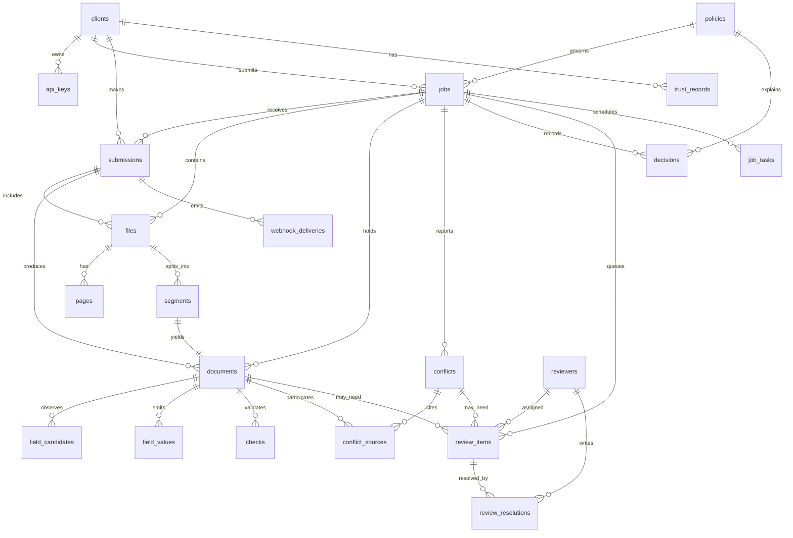

# 03 — Database Schema

## 1. Principles

- **PostgreSQL 16** is the only stateful dependency. It is the system of record and the job queue.
- **Text IDs** (`job_…`, `doc_…`) are used instead of UUID columns. They are portable, readable in
  logs, safe in URLs and do not leak sequencing. Uniqueness comes from `uuid4().hex`.
- **Timestamps are `timestamptz` in UTC.** The application never stores local time.
- **Stated values are text.** `field_values.value` preserves what the page says. Normalized values
  used by checks live in `field_values.normalized_value` and are never emitted by the API.
- **Provenance is a column, not a convention.** `field_values.bbox` is `NOT NULL`.
- **Extraction records outlive files.** `files` and `pages` are purgeable; `documents`,
  `field_values`, `checks`, `conflicts` and `review_resolutions` are retained.
- **Every mutable table has `created_at` and `updated_at`.** Audit tables are append-only.
- **No document content in logs.** The schema stores content only where the product requires it:
  source files in object storage, extraction records in Postgres, and resolution records in the
  review tables.

## 2. Relationship map



## 3. Table catalog

| Table | Purpose | Growth | Purgeable |
|---|---|---|---|
| `clients` | Tenant account, webhook config, retention terms. | Tiny | No |
| `api_keys` | Hashed public API credentials and scopes. | Tiny | No |
| `reviewers` | Internal review-console users. | Tiny | No |
| `policies` | Immutable, versioned decision policy. | Tiny | No |
| `jobs` | Logical accumulator for a `job_ref`. | Medium | No |
| `submissions` | One API call; one `result_id`. | Medium | No |
| `files` | Uploaded container and storage pointer. | Medium | Metadata only |
| `pages` | Page image, text-layer facts, legibility. | Large | Metadata only |
| `segments` | Non-overlapping page ranges and document types. | Large | No |
| `documents` | Extraction record root and immutable snapshot. | Large | No |
| `field_candidates` | Every reader's candidate for a field. | Very large | No |
| `field_values` | Emitted value, provenance, agreement. | Very large | No |
| `checks` | Deterministic check outcomes. | Large | No |
| `conflicts` | Cross-document disagreements. | Medium | No |
| `conflict_sources` | Documents and values behind a conflict. | Medium | No |
| `decisions` | Document and job decisions with policy version. | Large | No |
| `review_items` | Two-track queue entries. | Medium | No |
| `review_resolutions` | Labelled correction/confirmation records. | Medium | No |
| `trust_records` | Trust state per client/supplier/type/fingerprint. | Small | No |
| `job_tasks` | Durable queue. | Large | Terminal tasks after 30 days |
| `task_attempts` | Per-attempt diagnostics. | Large | After 30 days |
| `webhook_deliveries` | Outbox and delivery attempts. | Medium | After 90 days |
| `provider_calls` | Model-call ledger without content. | Very large | After 180 days |
| `audit_events` | Append-only operator and client actions. | Large | After 1 year |
| `retention_sweeps` | Retention run evidence and alerts. | Small | After 1 year |
| `client_usage_daily` | Quotas, billing, review-rate measurement. | Small | After 2 years |

## 4. Enumerations and invariants

Enums are `text` plus `CHECK` constraints, not Postgres enum types. Adding a value is a normal
migration and does not require `ALTER TYPE` coordination.

| Domain | Values |
|---|---|
| Client status | `active`, `suspended`, `terminated` |
| Job status | `queued`, `processing`, `review_required`, `completed`, `failed` |
| Submission status | `queued`, `processing`, `completed`, `failed` |
| File status | `received`, `processing`, `processed`, `failed`, `purged` |
| Page status | `pending`, `conditioned`, `unreadable`, `read` |
| Segment status | `pending`, `extracting`, `extracted`, `failed` |
| Document status | `queued`, `processing`, `extracted`, `review_required`, `resolved`, `unreadable`, `failed` |
| Decision value | `pass`, `review`, `unreadable`, `failed` |
| Decision route | `none`, `extraction`, `conflict` |
| Check status | `pass`, `fail`, `warn`, `skipped` |
| Check severity | `info`, `warning`, `blocking` |
| Conflict status | `open`, `resolved`, `waived` |
| Review track | `extraction`, `conflict` |
| Review status | `open`, `in_progress`, `resolved`, `dismissed` |
| Resolution outcome | `corrected`, `confirmed`, `accepted`, `waived`, `unreadable_confirmed` |
| Task status | `queued`, `running`, `succeeded`, `failed`, `dead` |
| Trust state | `unseen`, `observed`, `trusted` |
| Document type | `commercial_invoice`, `proforma_invoice`, `bill_of_lading`, `delivery_order`, `port_pass`, `custom_entry`, `verification_memo`, `packing_list`, `unknown` |

Invariants enforced by the database:

1. A page belongs to exactly one file; `(file_id, page_index)` is unique.
2. Segment page ranges cannot overlap within a file.
3. Every segment becomes at most one document; `documents.segment_id` is unique.
4. A document's `(job_id, idempotency_key)` is unique.
5. A review item belongs to exactly one track; an extraction item has a document and no conflict; a
   conflict item has a conflict and no document.
6. At most one open extraction item exists per document and one open conflict item per conflict.
7. `terminal_at` and `terminal_reason` are set together.
8. A `pass` decision is impossible for a document with a blocking failed check, an unreadable page,
   or an open conflict; the application enforces this, and the decision record carries the reasons.
9. `field_values.bbox` is never null and always names a page.
10. A conflict never stores a chosen winner. It stores only sources and status.

## 5. DDL — identity, policy and jobs

```sql
CREATE EXTENSION IF NOT EXISTS btree_gist;

CREATE OR REPLACE FUNCTION set_updated_at()
RETURNS trigger
LANGUAGE plpgsql
AS $$
BEGIN
    NEW.updated_at = now();
    RETURN NEW;
END;
$$;

-- ---------------------------------------------------------------------------
-- Tenants and credentials
-- ---------------------------------------------------------------------------

CREATE TABLE clients (
    id                              text PRIMARY KEY,
    name                            text NOT NULL,
    slug                            text NOT NULL UNIQUE,
    status                          text NOT NULL DEFAULT 'active'
                                    CHECK (status IN ('active', 'suspended', 'terminated')),
    webhook_url                     text,
    webhook_secret_ciphertext       bytea,
    webhook_enabled                 boolean NOT NULL DEFAULT false,
    retention_days_after_termination integer NOT NULL DEFAULT 90
                                    CHECK (retention_days_after_termination >= 0),
    created_at                      timestamptz NOT NULL DEFAULT now(),
    updated_at                      timestamptz NOT NULL DEFAULT now(),
    terminated_at                   timestamptz,
    CHECK (webhook_enabled = false OR webhook_url IS NOT NULL)
);

CREATE TABLE api_keys (
    id              text PRIMARY KEY,
    client_id       text NOT NULL REFERENCES clients(id) ON DELETE CASCADE,
    name            text NOT NULL,
    key_prefix      text NOT NULL,
    key_hash        text NOT NULL UNIQUE,
    scopes          text[] NOT NULL DEFAULT ARRAY['extract:write', 'results:read'],
    last_used_at    timestamptz,
    expires_at      timestamptz,
    revoked_at      timestamptz,
    created_at      timestamptz NOT NULL DEFAULT now()
);

CREATE INDEX ix_api_keys_client ON api_keys (client_id) WHERE revoked_at IS NULL;
CREATE UNIQUE INDEX ux_api_keys_prefix_active
    ON api_keys (key_prefix) WHERE revoked_at IS NULL;

-- ---------------------------------------------------------------------------
-- Review-console users
-- ---------------------------------------------------------------------------

CREATE TABLE reviewers (
    id              text PRIMARY KEY,
    username        text NOT NULL,
    password_hash   text NOT NULL,
    display_name    text NOT NULL,
    role            text NOT NULL DEFAULT 'reviewer'
                    CHECK (role IN ('reviewer', 'admin', 'auditor')),
    is_active       boolean NOT NULL DEFAULT true,
    session_epoch   integer NOT NULL DEFAULT 0,
    last_login_at   timestamptz,
    created_at      timestamptz NOT NULL DEFAULT now(),
    updated_at      timestamptz NOT NULL DEFAULT now()
);

CREATE UNIQUE INDEX ux_reviewers_username_lower ON reviewers (lower(username));

-- ---------------------------------------------------------------------------
-- Versioned policy
-- ---------------------------------------------------------------------------

CREATE TABLE policies (
    id              text PRIMARY KEY,
    version         integer NOT NULL UNIQUE CHECK (version > 0),
    name            text NOT NULL,
    config          jsonb NOT NULL,
    status          text NOT NULL DEFAULT 'draft'
                    CHECK (status IN ('draft', 'active', 'retired')),
    created_by      text REFERENCES reviewers(id) ON DELETE SET NULL,
    created_at      timestamptz NOT NULL DEFAULT now(),
    activated_at    timestamptz,
    retired_at      timestamptz,
    CHECK (status <> 'active' OR activated_at IS NOT NULL)
);

CREATE UNIQUE INDEX ux_policies_one_active ON policies (status) WHERE status = 'active';
CREATE INDEX ix_policies_status ON policies (status, version DESC);

-- ---------------------------------------------------------------------------
-- Jobs: the logical accumulator
-- ---------------------------------------------------------------------------

CREATE TABLE jobs (
    id                  text PRIMARY KEY,
    client_id           text NOT NULL REFERENCES clients(id) ON DELETE RESTRICT,
    job_ref             text,
    status              text NOT NULL DEFAULT 'queued'
                        CHECK (status IN ('queued', 'processing', 'review_required',
                                          'completed', 'failed')),
    policy_id           text NOT NULL REFERENCES policies(id) ON DELETE RESTRICT,
    document_count      integer NOT NULL DEFAULT 0 CHECK (document_count >= 0),
    open_review_count   integer NOT NULL DEFAULT 0 CHECK (open_review_count >= 0),
    open_conflict_count integer NOT NULL DEFAULT 0 CHECK (open_conflict_count >= 0),
    terminal_at         timestamptz,
    terminal_reason     text CHECK (terminal_reason IN ('completed', 'failed', 'cancelled')),
    created_at          timestamptz NOT NULL DEFAULT now(),
    updated_at          timestamptz NOT NULL DEFAULT now(),
    last_submission_at  timestamptz NOT NULL DEFAULT now(),
    CHECK ((terminal_at IS NULL) = (terminal_reason IS NULL))
);

CREATE UNIQUE INDEX ux_jobs_client_ref
    ON jobs (client_id, job_ref) WHERE job_ref IS NOT NULL;
CREATE INDEX ix_jobs_client_created ON jobs (client_id, created_at DESC);
CREATE INDEX ix_jobs_status ON jobs (status, updated_at);
CREATE INDEX ix_jobs_terminal ON jobs (terminal_at)
    WHERE terminal_at IS NOT NULL;

-- ---------------------------------------------------------------------------
-- Submissions: one API call, one result
-- ---------------------------------------------------------------------------

CREATE TABLE submissions (
    id                  text PRIMARY KEY,
    result_id           text NOT NULL UNIQUE,
    job_id              text NOT NULL REFERENCES jobs(id) ON DELETE CASCADE,
    client_id           text NOT NULL REFERENCES clients(id) ON DELETE RESTRICT,
    status              text NOT NULL DEFAULT 'queued'
                        CHECK (status IN ('queued', 'processing', 'completed', 'failed')),
    webhook_url         text,
    idempotency_key     text,
    request_fingerprint text,
    document_count      integer NOT NULL DEFAULT 0 CHECK (document_count >= 0),
    duplicate_count     integer NOT NULL DEFAULT 0 CHECK (duplicate_count >= 0),
    error_code          text,
    error_message       text,
    created_at          timestamptz NOT NULL DEFAULT now(),
    completed_at        timestamptz
);

CREATE UNIQUE INDEX ux_submissions_client_idempotency
    ON submissions (client_id, idempotency_key) WHERE idempotency_key IS NOT NULL;
CREATE INDEX ix_submissions_job ON submissions (job_id, created_at);
CREATE INDEX ix_submissions_client_created ON submissions (client_id, created_at DESC);

-- ---------------------------------------------------------------------------
-- Files: uploaded containers
-- ---------------------------------------------------------------------------

CREATE TABLE files (
    id              text PRIMARY KEY,
    submission_id   text NOT NULL REFERENCES submissions(id) ON DELETE CASCADE,
    job_id          text NOT NULL REFERENCES jobs(id) ON DELETE CASCADE,
    client_id       text NOT NULL REFERENCES clients(id) ON DELETE RESTRICT,
    filename        text NOT NULL,
    content_type    text NOT NULL,
    size_bytes      bigint NOT NULL CHECK (size_bytes > 0),
    sha256          char(64) NOT NULL,
    storage_key     text NOT NULL,
    page_count      integer CHECK (page_count IS NULL OR page_count > 0),
    status          text NOT NULL DEFAULT 'received'
                    CHECK (status IN ('received', 'processing', 'processed',
                                      'failed', 'purged')),
    error_code      text,
    error_message   text,
    created_at      timestamptz NOT NULL DEFAULT now(),
    processed_at    timestamptz,
    purged_at       timestamptz
);

CREATE UNIQUE INDEX ux_files_job_sha256 ON files (job_id, sha256);
CREATE INDEX ix_files_submission ON files (submission_id);
CREATE INDEX ix_files_job ON files (job_id);
CREATE INDEX ix_files_purgeable ON files (job_id) WHERE purged_at IS NULL;

-- ---------------------------------------------------------------------------
-- Pages: the atom
-- ---------------------------------------------------------------------------

CREATE TABLE pages (
    id                  text PRIMARY KEY,
    file_id             text NOT NULL REFERENCES files(id) ON DELETE CASCADE,
    page_index          integer NOT NULL CHECK (page_index >= 0),
    width_px            integer NOT NULL CHECK (width_px > 0),
    height_px           integer NOT NULL CHECK (height_px > 0),
    dpi                 integer NOT NULL DEFAULT 300 CHECK (dpi > 0),
    rotation_deg        numeric(6,2) NOT NULL DEFAULT 0,
    text_layer_present  boolean NOT NULL DEFAULT false,
    text_layer_chars    integer NOT NULL DEFAULT 0 CHECK (text_layer_chars >= 0),
    text_layer          text,
    legibility_score    numeric(5,4) CHECK (legibility_score BETWEEN 0 AND 1),
    conditioning        jsonb NOT NULL DEFAULT '{}'::jsonb,
    conditioning_version text,
    status              text NOT NULL DEFAULT 'pending'
                        CHECK (status IN ('pending', 'conditioned', 'unreadable', 'read')),
    unreadable_reason   text,
    image_key           text,
    thumbnail_key       text,
    created_at          timestamptz NOT NULL DEFAULT now(),
    updated_at          timestamptz NOT NULL DEFAULT now(),
    conditioned_at      timestamptz,
    purged_at           timestamptz,
    CONSTRAINT ux_pages_file_page UNIQUE (file_id, page_index)
);

CREATE INDEX ix_pages_file ON pages (file_id, page_index);
CREATE INDEX ix_pages_status ON pages (status);

-- ---------------------------------------------------------------------------
-- Segments: non-overlapping page ranges
-- ---------------------------------------------------------------------------

CREATE TABLE segments (
    id              text PRIMARY KEY,
    file_id         text NOT NULL REFERENCES files(id) ON DELETE CASCADE,
    job_id          text NOT NULL REFERENCES jobs(id) ON DELETE CASCADE,
    page_start      integer NOT NULL CHECK (page_start >= 0),
    page_end        integer NOT NULL CHECK (page_end >= page_start),
    document_type   text NOT NULL CHECK (document_type IN (
                        'commercial_invoice', 'proforma_invoice', 'bill_of_lading',
                        'delivery_order', 'port_pass', 'custom_entry',
                        'verification_memo', 'packing_list', 'unknown')),
    confidence      numeric(5,4) NOT NULL CHECK (confidence BETWEEN 0 AND 1),
    fingerprint     text NOT NULL,
    status          text NOT NULL DEFAULT 'pending'
                    CHECK (status IN ('pending', 'extracting', 'extracted', 'failed')),
    created_at      timestamptz NOT NULL DEFAULT now(),
    updated_at      timestamptz NOT NULL DEFAULT now(),
    EXCLUDE USING gist (
        file_id WITH =,
        int4range(page_start, page_end, '[]') WITH &&
    )
);

CREATE INDEX ix_segments_file ON segments (file_id, page_start);
CREATE INDEX ix_segments_job ON segments (job_id);
CREATE INDEX ix_segments_type ON segments (document_type);
```

## 6. DDL — extraction records

```sql
-- ---------------------------------------------------------------------------
-- Documents: one extraction record per segment
-- ---------------------------------------------------------------------------

CREATE TABLE documents (
    id                  text PRIMARY KEY,
    job_id              text NOT NULL REFERENCES jobs(id) ON DELETE CASCADE,
    submission_id       text NOT NULL REFERENCES submissions(id) ON DELETE CASCADE,
    file_id             text NOT NULL REFERENCES files(id) ON DELETE CASCADE,
    segment_id          text NOT NULL UNIQUE REFERENCES segments(id) ON DELETE CASCADE,
    client_id           text NOT NULL REFERENCES clients(id) ON DELETE RESTRICT,
    document_type       text NOT NULL CHECK (document_type IN (
                            'commercial_invoice', 'proforma_invoice', 'bill_of_lading',
                            'delivery_order', 'port_pass', 'custom_entry',
                            'verification_memo', 'packing_list', 'unknown')),
    document_number     text,
    supplier_name       text,
    supplier_key        text,
    template_fingerprint text,
    source_file_hash    char(64) NOT NULL,
    document_hash       char(64) NOT NULL,
    idempotency_key     text NOT NULL,
    status              text NOT NULL DEFAULT 'queued'
                        CHECK (status IN ('queued', 'processing', 'extracted',
                                          'review_required', 'resolved',
                                          'unreadable', 'failed')),
    decision            text CHECK (decision IN ('pass', 'review', 'unreadable', 'failed')),
    decision_reason     text,
    extraction          jsonb,
    provenance_version  text NOT NULL DEFAULT '1.0',
    page_start          integer NOT NULL CHECK (page_start >= 0),
    page_end            integer NOT NULL CHECK (page_end >= page_start),
    created_at          timestamptz NOT NULL DEFAULT now(),
    updated_at          timestamptz NOT NULL DEFAULT now(),
    extracted_at        timestamptz,
    resolved_at         timestamptz,
    purged_at           timestamptz,
    UNIQUE (job_id, idempotency_key),
    UNIQUE (job_id, document_hash)
);

CREATE INDEX ix_documents_job ON documents (job_id, created_at);
CREATE INDEX ix_documents_submission ON documents (submission_id);
CREATE INDEX ix_documents_client_created ON documents (client_id, created_at DESC);
CREATE INDEX ix_documents_status ON documents (status);
CREATE INDEX ix_documents_type ON documents (document_type);

-- ---------------------------------------------------------------------------
-- Reader candidates: every reader's observation, retained for review
-- ---------------------------------------------------------------------------

CREATE TABLE field_candidates (
    id              text PRIMARY KEY,
    document_id     text NOT NULL REFERENCES documents(id) ON DELETE CASCADE,
    page_id         text NOT NULL REFERENCES pages(id) ON DELETE CASCADE,
    field_path      text NOT NULL,
    section         text NOT NULL,
    reader          text NOT NULL
                    CHECK (reader IN ('text_layer', 'paddle', 'vision', 'human')),
    raw_text        text,
    value           text,
    value_type      text NOT NULL DEFAULT 'string'
                    CHECK (value_type IN ('string', 'decimal', 'integer', 'date',
                                          'datetime', 'boolean', 'enum')),
    bbox            jsonb NOT NULL,
    confidence      numeric(5,4) CHECK (confidence BETWEEN 0 AND 1),
    model           text,
    reader_version  text,
    created_at      timestamptz NOT NULL DEFAULT now()
);

CREATE INDEX ix_field_candidates_document_path
    ON field_candidates (document_id, field_path);
CREATE INDEX ix_field_candidates_document_reader
    ON field_candidates (document_id, reader);
CREATE INDEX ix_field_candidates_page ON field_candidates (page_id);

-- ---------------------------------------------------------------------------
-- Emitted values: one per document field, provenance mandatory
-- ---------------------------------------------------------------------------

CREATE TABLE field_values (
    id                  text PRIMARY KEY,
    document_id         text NOT NULL REFERENCES documents(id) ON DELETE CASCADE,
    page_id             text NOT NULL REFERENCES pages(id) ON DELETE CASCADE,
    field_path          text NOT NULL,
    section             text NOT NULL,
    value               text NOT NULL,
    value_type          text NOT NULL DEFAULT 'string'
                        CHECK (value_type IN ('string', 'decimal', 'integer', 'date',
                                              'datetime', 'boolean', 'enum')),
    raw_text            text,
    bbox                jsonb NOT NULL,
    reader              text NOT NULL
                        CHECK (reader IN ('text_layer', 'paddle', 'vision', 'human')),
    model               text,
    confidence          numeric(5,4) CHECK (confidence BETWEEN 0 AND 1),
    agreement           text NOT NULL DEFAULT 'single_reader'
                        CHECK (agreement IN ('unanimous', 'majority', 'single_reader',
                                             'disputed', 'human_corrected')),
    selected_candidate_id text REFERENCES field_candidates(id) ON DELETE SET NULL,
    normalized_value    jsonb,
    provenance_hash     char(64) NOT NULL,
    created_at          timestamptz NOT NULL DEFAULT now(),
    updated_at          timestamptz NOT NULL DEFAULT now(),
    UNIQUE (document_id, field_path)
);

CREATE INDEX ix_field_values_document_section
    ON field_values (document_id, section, field_path);
CREATE INDEX ix_field_values_path ON field_values (field_path);
CREATE INDEX ix_field_values_disputed
    ON field_values (document_id) WHERE agreement = 'disputed';

-- ---------------------------------------------------------------------------
-- Deterministic checks
-- ---------------------------------------------------------------------------

CREATE TABLE checks (
    id              text PRIMARY KEY,
    document_id     text NOT NULL REFERENCES documents(id) ON DELETE CASCADE,
    job_id          text NOT NULL REFERENCES jobs(id) ON DELETE CASCADE,
    check_code      text NOT NULL,
    check_version   text NOT NULL DEFAULT '1.0',
    tier            smallint NOT NULL DEFAULT 1 CHECK (tier BETWEEN 1 AND 3),
    status          text NOT NULL
                    CHECK (status IN ('pass', 'fail', 'warn', 'skipped')),
    field_path      text,
    expected        jsonb,
    actual          jsonb,
    message         text NOT NULL,
    severity        text NOT NULL DEFAULT 'blocking'
                    CHECK (severity IN ('info', 'warning', 'blocking')),
    created_at      timestamptz NOT NULL DEFAULT now(),
    UNIQUE (document_id, check_code)
);

CREATE INDEX ix_checks_document_status ON checks (document_id, status);
CREATE INDEX ix_checks_job_status ON checks (job_id, status);

-- ---------------------------------------------------------------------------
-- Conflicts: reported, never resolved by the platform
-- ---------------------------------------------------------------------------

CREATE TABLE conflicts (
    id              text PRIMARY KEY,
    job_id          text NOT NULL REFERENCES jobs(id) ON DELETE CASCADE,
    canonical_key   text NOT NULL,
    field_label     text NOT NULL,
    fingerprint     char(64) NOT NULL,
    status          text NOT NULL DEFAULT 'open'
                    CHECK (status IN ('open', 'resolved', 'waived')),
    first_seen_at   timestamptz NOT NULL DEFAULT now(),
    last_seen_at    timestamptz NOT NULL DEFAULT now(),
    resolved_at     timestamptz,
    created_at      timestamptz NOT NULL DEFAULT now(),
    updated_at      timestamptz NOT NULL DEFAULT now(),
    UNIQUE (job_id, canonical_key, fingerprint)
);

CREATE INDEX ix_conflicts_job_status ON conflicts (job_id, status);
CREATE INDEX ix_conflicts_open ON conflicts (job_id)
    WHERE status = 'open';

CREATE TABLE conflict_sources (
    id                  text PRIMARY KEY,
    conflict_id         text NOT NULL REFERENCES conflicts(id) ON DELETE CASCADE,
    document_id         text NOT NULL REFERENCES documents(id) ON DELETE CASCADE,
    field_value_id      text NOT NULL REFERENCES field_values(id) ON DELETE CASCADE,
    stated_value        text NOT NULL,
    normalized_value    jsonb,
    created_at          timestamptz NOT NULL DEFAULT now(),
    UNIQUE (conflict_id, document_id, field_value_id)
);

CREATE INDEX ix_conflict_sources_conflict ON conflict_sources (conflict_id);
CREATE INDEX ix_conflict_sources_document ON conflict_sources (document_id);

-- ---------------------------------------------------------------------------
-- Decisions: document-level and job-level, with policy provenance
-- ---------------------------------------------------------------------------

CREATE TABLE decisions (
    id              text PRIMARY KEY,
    job_id          text NOT NULL REFERENCES jobs(id) ON DELETE CASCADE,
    submission_id   text REFERENCES submissions(id) ON DELETE CASCADE,
    document_id     text REFERENCES documents(id) ON DELETE CASCADE,
    scope           text NOT NULL CHECK (scope IN ('document', 'job')),
    decision        text NOT NULL
                    CHECK (decision IN ('pass', 'review', 'unreadable', 'failed')),
    route           text NOT NULL DEFAULT 'none'
                    CHECK (route IN ('none', 'extraction', 'conflict')),
    reason_codes    text[] NOT NULL DEFAULT '{}',
    reason          text NOT NULL,
    policy_id       text NOT NULL REFERENCES policies(id) ON DELETE RESTRICT,
    policy_version  integer NOT NULL,
    created_at      timestamptz NOT NULL DEFAULT now(),
    CHECK ((scope = 'document' AND document_id IS NOT NULL)
        OR (scope = 'job' AND document_id IS NULL))
);

CREATE INDEX ix_decisions_job ON decisions (job_id, created_at DESC);
CREATE INDEX ix_decisions_document ON decisions (document_id, created_at DESC);
CREATE INDEX ix_decisions_policy ON decisions (policy_version);

-- ---------------------------------------------------------------------------
-- Review queue: two tracks, never merged
-- ---------------------------------------------------------------------------

CREATE TABLE review_items (
    id              text PRIMARY KEY,
    job_id          text NOT NULL REFERENCES jobs(id) ON DELETE CASCADE,
    document_id     text REFERENCES documents(id) ON DELETE CASCADE,
    conflict_id     text REFERENCES conflicts(id) ON DELETE CASCADE,
    track           text NOT NULL CHECK (track IN ('extraction', 'conflict')),
    status          text NOT NULL DEFAULT 'open'
                    CHECK (status IN ('open', 'in_progress', 'resolved', 'dismissed')),
    priority        smallint NOT NULL DEFAULT 100,
    reason_code     text NOT NULL,
    summary         text NOT NULL,
    assigned_to     text REFERENCES reviewers(id) ON DELETE SET NULL,
    due_at          timestamptz,
    created_at      timestamptz NOT NULL DEFAULT now(),
    updated_at      timestamptz NOT NULL DEFAULT now(),
    resolved_at     timestamptz,
    CHECK ((track = 'extraction' AND document_id IS NOT NULL AND conflict_id IS NULL)
        OR (track = 'conflict' AND conflict_id IS NOT NULL AND document_id IS NULL))
);

CREATE UNIQUE INDEX ux_review_open_document
    ON review_items (document_id)
    WHERE track = 'extraction' AND status IN ('open', 'in_progress');
CREATE UNIQUE INDEX ux_review_open_conflict
    ON review_items (conflict_id)
    WHERE track = 'conflict' AND status IN ('open', 'in_progress');
CREATE INDEX ix_review_queue
    ON review_items (track, status, priority, created_at);
CREATE INDEX ix_review_assigned
    ON review_items (assigned_to, status) WHERE assigned_to IS NOT NULL;

CREATE TABLE review_resolutions (
    id              text PRIMARY KEY,
    review_item_id  text NOT NULL REFERENCES review_items(id) ON DELETE CASCADE,
    reviewer_id     text NOT NULL REFERENCES reviewers(id) ON DELETE RESTRICT,
    field_path      text,
    prior_value     text,
    corrected_value text,
    outcome         text NOT NULL
                    CHECK (outcome IN ('corrected', 'confirmed', 'accepted',
                                       'waived', 'unreadable_confirmed')),
    reason          text NOT NULL,
    metadata        jsonb NOT NULL DEFAULT '{}'::jsonb,
    created_at      timestamptz NOT NULL DEFAULT now()
);

CREATE INDEX ix_review_resolutions_item ON review_resolutions (review_item_id);
CREATE INDEX ix_review_resolutions_reviewer ON review_resolutions (reviewer_id, created_at DESC);

-- ---------------------------------------------------------------------------
-- Trust records: scaffolding; no automatic promotion in v1
-- ---------------------------------------------------------------------------

CREATE TABLE trust_records (
    id                  text PRIMARY KEY,
    client_id           text NOT NULL REFERENCES clients(id) ON DELETE CASCADE,
    supplier_key        text NOT NULL,
    document_type       text NOT NULL,
    template_fingerprint text NOT NULL,
    state               text NOT NULL DEFAULT 'unseen'
                        CHECK (state IN ('unseen', 'observed', 'trusted')),
    review_rate         numeric(4,3) NOT NULL DEFAULT 1.000
                        CHECK (review_rate BETWEEN 0 AND 1),
    documents_seen      integer NOT NULL DEFAULT 0 CHECK (documents_seen >= 0),
    corrections         integer NOT NULL DEFAULT 0 CHECK (corrections >= 0),
    last_correction_at  timestamptz,
    created_at          timestamptz NOT NULL DEFAULT now(),
    updated_at          timestamptz NOT NULL DEFAULT now(),
    UNIQUE (client_id, supplier_key, document_type, template_fingerprint)
);

CREATE INDEX ix_trust_lookup
    ON trust_records (client_id, document_type, template_fingerprint);

-- ---------------------------------------------------------------------------
-- Durable queue
-- ---------------------------------------------------------------------------

CREATE TABLE job_tasks (
    id              text PRIMARY KEY,
    job_id          text NOT NULL REFERENCES jobs(id) ON DELETE CASCADE,
    submission_id   text REFERENCES submissions(id) ON DELETE CASCADE,
    document_id     text REFERENCES documents(id) ON DELETE CASCADE,
    segment_id      text REFERENCES segments(id) ON DELETE CASCADE,
    kind            text NOT NULL CHECK (kind IN (
                        'prepare_file', 'segment_file', 'extract_segment',
                        'finalize_submission', 'deliver_webhook',
                        'purge_documents', 'recover_stale')),
    status          text NOT NULL DEFAULT 'queued'
                    CHECK (status IN ('queued', 'running', 'succeeded', 'failed', 'dead')),
    priority        smallint NOT NULL DEFAULT 100,
    run_after       timestamptz NOT NULL DEFAULT now(),
    attempts        integer NOT NULL DEFAULT 0 CHECK (attempts >= 0),
    max_attempts    integer NOT NULL DEFAULT 3 CHECK (max_attempts > 0),
    dedupe_key      text UNIQUE,
    locked_by       text,
    locked_at       timestamptz,
    started_at      timestamptz,
    finished_at     timestamptz,
    last_error_code text,
    last_error      text,
    payload         jsonb NOT NULL DEFAULT '{}'::jsonb,
    created_at      timestamptz NOT NULL DEFAULT now(),
    updated_at      timestamptz NOT NULL DEFAULT now(),
    CHECK (status <> 'running' OR locked_by IS NOT NULL)
);

CREATE INDEX ix_tasks_claim
    ON job_tasks (status, run_after, priority DESC, created_at)
    WHERE status = 'queued';
CREATE INDEX ix_tasks_running
    ON job_tasks (locked_at) WHERE status = 'running';
CREATE INDEX ix_tasks_job ON job_tasks (job_id, created_at);
CREATE INDEX ix_tasks_dead ON job_tasks (status) WHERE status = 'dead';

CREATE TABLE task_attempts (
    id              text PRIMARY KEY,
    task_id         text NOT NULL REFERENCES job_tasks(id) ON DELETE CASCADE,
    attempt         integer NOT NULL CHECK (attempt > 0),
    worker_id       text NOT NULL,
    started_at      timestamptz NOT NULL DEFAULT now(),
    finished_at     timestamptz,
    duration_ms     integer,
    error_code      text,
    error_message   text,
    UNIQUE (task_id, attempt)
);

CREATE INDEX ix_task_attempts_task ON task_attempts (task_id, attempt);

-- ---------------------------------------------------------------------------
-- Webhook outbox
-- ---------------------------------------------------------------------------

CREATE TABLE webhook_deliveries (
    id              text PRIMARY KEY,
    submission_id   text NOT NULL REFERENCES submissions(id) ON DELETE CASCADE,
    job_id          text NOT NULL REFERENCES jobs(id) ON DELETE CASCADE,
    event_type      text NOT NULL CHECK (event_type IN (
                        'result.completed', 'result.review_required', 'result.failed')),
    url             text NOT NULL,
    payload         jsonb NOT NULL,
    payload_sha256  char(64) NOT NULL,
    status          text NOT NULL DEFAULT 'pending'
                    CHECK (status IN ('pending', 'delivering', 'delivered',
                                      'failed', 'dead')),
    attempts        integer NOT NULL DEFAULT 0 CHECK (attempts >= 0),
    next_attempt_at timestamptz NOT NULL DEFAULT now(),
    last_status_code integer,
    last_error      text,
    created_at      timestamptz NOT NULL DEFAULT now(),
    delivered_at    timestamptz,
    UNIQUE (submission_id, event_type)
);

CREATE INDEX ix_webhooks_due
    ON webhook_deliveries (next_attempt_at)
    WHERE status IN ('pending', 'failed');
CREATE INDEX ix_webhooks_submission ON webhook_deliveries (submission_id);

-- ---------------------------------------------------------------------------
-- Provider-call ledger: no document content
-- ---------------------------------------------------------------------------

CREATE TABLE provider_calls (
    id              text PRIMARY KEY,
    job_id          text REFERENCES jobs(id) ON DELETE SET NULL,
    document_id     text REFERENCES documents(id) ON DELETE SET NULL,
    page_id         text REFERENCES pages(id) ON DELETE SET NULL,
    reader          text NOT NULL CHECK (reader IN ('text_layer', 'paddle', 'vision', 'text')),
    provider        text NOT NULL,
    model           text NOT NULL,
    operation       text NOT NULL,
    prompt_hash     char(64),
    input_tokens    integer NOT NULL DEFAULT 0 CHECK (input_tokens >= 0),
    output_tokens   integer NOT NULL DEFAULT 0 CHECK (output_tokens >= 0),
    cached_tokens   integer NOT NULL DEFAULT 0 CHECK (cached_tokens >= 0),
    latency_ms      integer NOT NULL DEFAULT 0 CHECK (latency_ms >= 0),
    status          text NOT NULL CHECK (status IN ('ok', 'error', 'timeout', 'rate_limited')),
    error_code      text,
    created_at      timestamptz NOT NULL DEFAULT now()
);

CREATE INDEX ix_provider_calls_job ON provider_calls (job_id, created_at);
CREATE INDEX ix_provider_calls_created ON provider_calls (created_at);

-- ---------------------------------------------------------------------------
-- Audit and retention evidence
-- ---------------------------------------------------------------------------

CREATE TABLE audit_events (
    id              text PRIMARY KEY,
    client_id       text REFERENCES clients(id) ON DELETE SET NULL,
    actor_type      text NOT NULL CHECK (actor_type IN ('client', 'reviewer', 'system')),
    actor_id        text,
    action          text NOT NULL,
    target_type     text NOT NULL,
    target_id       text NOT NULL,
    metadata        jsonb NOT NULL DEFAULT '{}'::jsonb,
    request_id      text,
    created_at      timestamptz NOT NULL DEFAULT now()
);

CREATE INDEX ix_audit_target ON audit_events (target_type, target_id, created_at DESC);
CREATE INDEX ix_audit_client ON audit_events (client_id, created_at DESC);

CREATE TABLE retention_sweeps (
    id                  text PRIMARY KEY,
    started_at          timestamptz NOT NULL DEFAULT now(),
    finished_at         timestamptz,
    jobs_examined       integer NOT NULL DEFAULT 0,
    objects_deleted     integer NOT NULL DEFAULT 0,
    bytes_deleted       bigint NOT NULL DEFAULT 0,
    failures            integer NOT NULL DEFAULT 0,
    oldest_overdue_at   timestamptz,
    status              text NOT NULL DEFAULT 'running'
                        CHECK (status IN ('running', 'succeeded', 'failed')),
    error               text
);

CREATE INDEX ix_retention_sweeps_started ON retention_sweeps (started_at DESC);

CREATE TABLE client_usage_daily (
    client_id           text NOT NULL REFERENCES clients(id) ON DELETE CASCADE,
    day                 date NOT NULL,
    submissions         integer NOT NULL DEFAULT 0,
    documents           integer NOT NULL DEFAULT 0,
    pages               integer NOT NULL DEFAULT 0,
    provider_input_tokens  bigint NOT NULL DEFAULT 0,
    provider_output_tokens bigint NOT NULL DEFAULT 0,
    review_items_opened integer NOT NULL DEFAULT 0,
    review_items_resolved integer NOT NULL DEFAULT 0,
    PRIMARY KEY (client_id, day)
);

-- ---------------------------------------------------------------------------
-- Updated-at triggers
-- ---------------------------------------------------------------------------

DO $$
DECLARE
    table_name text;
BEGIN
    FOREACH table_name IN ARRAY ARRAY[
        'clients', 'reviewers', 'jobs', 'pages', 'segments', 'documents',
        'field_values', 'conflicts', 'review_items', 'trust_records', 'job_tasks'
    ] LOOP
        EXECUTE format(
            'CREATE TRIGGER trg_%1$s_updated_at
             BEFORE UPDATE ON %1$I
             FOR EACH ROW EXECUTE FUNCTION set_updated_at()',
            table_name
        );
    END LOOP;
END;
$$;
```

## 7. Views and query patterns

### Open review queues

```sql
CREATE VIEW v_open_review_items AS
SELECT
    ri.id,
    ri.track,
    ri.status,
    ri.priority,
    ri.reason_code,
    ri.summary,
    ri.created_at,
    ri.due_at,
    ri.document_id,
    ri.conflict_id,
    ri.job_id,
    j.job_ref,
    j.client_id,
    c.name AS client_name,
    r.display_name AS assignee
FROM review_items ri
JOIN jobs j ON j.id = ri.job_id
JOIN clients c ON c.id = j.client_id
LEFT JOIN reviewers r ON r.id = ri.assigned_to
WHERE ri.status IN ('open', 'in_progress');
```

### Retention due

```sql
CREATE VIEW v_retention_due AS
SELECT
    j.id AS job_id,
    j.client_id,
    j.terminal_at,
    j.terminal_reason,
    count(f.id) FILTER (WHERE f.purged_at IS NULL) AS files_to_purge,
    min(f.created_at) AS oldest_file_at
FROM jobs j
JOIN files f ON f.job_id = j.id
WHERE j.terminal_at IS NOT NULL
  AND j.terminal_at < now() - interval '6 hours'
  AND j.open_review_count = 0
  AND j.open_conflict_count = 0
GROUP BY j.id, j.client_id, j.terminal_at, j.terminal_reason;
```

> The `interval '6 hours'` above is illustrative. The sweeper passes `DOCUMENT_RETENTION_HOURS` as a
> bind parameter (`j.terminal_at < now() - make_interval(hours => :retention_hours)`); the view is a
> diagnostic aid, not the enforcement point.

### Queue claim

The only SQL outside repositories that is allowed to be hand-written, because it is the queue
contract:

```sql
WITH claimed AS (
    SELECT id
    FROM job_tasks
    WHERE status = 'queued'
      AND run_after <= now()
      AND kind = ANY(:kinds)
    ORDER BY priority DESC, run_after, created_at
    FOR UPDATE SKIP LOCKED
    LIMIT 1
)
UPDATE job_tasks t
SET status = 'running',
    locked_by = :worker_id,
    locked_at = now(),
    started_at = COALESCE(t.started_at, now()),
    attempts = t.attempts + 1
FROM claimed c
WHERE t.id = c.id
RETURNING t.*;
```

### Result assembly

Results are assembled from `documents`, `field_values`, `checks`, `conflicts` and
`conflict_sources`. The immutable `documents.extraction` JSONB snapshot is the canonical output for
a completed document; relational rows exist for review, conflicts and audit. The snapshot is
written once and never mutated. Corrections create a resolution record and a new snapshot version
in the review flow, not an in-place edit of the original.

## 8. State transitions and counters

Counters on `jobs` (`open_review_count`, `open_conflict_count`, `document_count`) are maintained in
the same transaction as the state change that causes them. A transaction that opens a review item
increments `open_review_count`; a transaction that resolves the last open item decrements it and,
if the job is otherwise complete, sets `status = 'completed'` and `terminal_at = now()`.

Document state:

```text
queued → processing → extracted → review_required → resolved
                    ↘ unreadable
                    ↘ failed
```

Job state:

```text
queued → processing → review_required → completed
                    ↘ completed
                    ↘ failed
completed → queued          (new submission under the same job_ref)
```

A completed job reopens on a new submission: `status = 'queued'`, `terminal_at = NULL`,
`terminal_reason = NULL`, `last_submission_at = now()`. The retained extraction records are used for
reconciliation; files that were already purged are not required to re-read old documents. A failed
job rejects new submissions with `409 job_failed`; the caller must use a new `job_ref`.

Counters are updated transactionally, but they are also reconciled nightly from `review_items` and
`conflicts`; a drift metric is emitted rather than trusted silently.

Task state:

```text
queued → running → succeeded
              ↘ failed → queued (attempts < max_attempts)
                       ↘ dead (attempts >= max_attempts)
```

## 9. Index strategy

| Query | Index |
|---|---|
| API key lookup | `ux_api_keys_prefix_active` |
| Job by `(client, job_ref)` | `ux_jobs_client_ref` |
| Result by id | `submissions.result_id` unique |
| Claim next task | `ix_tasks_claim` partial |
| Stale running tasks | `ix_tasks_running` partial |
| Tenant document list | `ix_documents_client_created` |
| Job result assembly | `ix_documents_job`, `ix_field_values_document_section` |
| Review queue | `ix_review_queue` |
| Open conflicts | `ix_conflicts_open` partial |
| Webhook retry | `ix_webhooks_due` partial |
| Retention due | `ix_jobs_terminal` partial |
| Field provenance lookup | `ix_field_values_document_section` |

Do not add indexes speculatively. Every index is a write cost on the extraction path. Add one only
after an `EXPLAIN (ANALYZE, BUFFERS)` shows the query is hot.

## 10. Retention semantics

| Data | Retention | Mechanism |
|---|---|---|
| Source files, page images, thumbnails, crops | 6 hours after `jobs.terminal_at` | `services.retention` sweeper; deletes object prefixes; sets `files.purged_at`, `pages.purged_at`. |
| Extraction records (`documents`, `field_values`, `checks`, `conflicts`) | Life of account + 90 days after termination | Never purged by the file sweeper; account deletion workflow. |
| `provider_calls` | 180 days | Maintenance job. No content. |
| `audit_events` | 1 year | Maintenance job. |
| `job_tasks`, `task_attempts` | 30 days after terminal | Maintenance job. |
| `webhook_deliveries` | 90 days | Maintenance job. |
| Database backups | Per infrastructure policy; state effective deletion date including backups. | Documented in the DPA and runbook. |
| Object-storage non-current versions | Same as source files | Bucket lifecycle rule; explicit delete markers. |

The extraction record is what answers a dispute months later. Purging the file does not purge the
record. The record is exportable in full and deletable on request before expiry.

## 11. Migrations

- Alembic owns every schema change. `alembic upgrade head` runs as a one-shot deployment job, never
  from the API process at startup in production.
- Migrations are forward-only. A destructive change is a two-step expand/contract migration.
- The initial migration creates the schema, extensions, views and triggers in one transaction.
- CI runs migrations against a fresh Postgres 16 container and then runs the integration suite.
- `alembic check` runs in CI to detect model/DDL drift.
- Migration files are reviewed like application code; no generated SQL is merged without reading
  it.

## 12. Data volume and partitioning

Baseline estimate for one 20-document job:

| Row type | Count |
|---|---|
| Files | 20 |
| Pages | 100 |
| Segments / documents | 20 |
| Field candidates | 20 × 80 × 2 readers ≈ 3,200 |
| Field values | 20 × 80 = 1,600 |
| Checks | 20 × 10 = 200 |

At 100 jobs/day this is roughly 320k candidate rows and 160k value rows per day. That is comfortable
for Postgres 16 with the indexes above. Partition only when measured:

- `provider_calls`, `audit_events`, `job_tasks`: monthly range partitions when the table exceeds
  ~50M rows or vacuum becomes a problem.
- `field_candidates`: consider monthly partitions or retention by job age when write amplification
  dominates.
- `field_values` and `documents` stay unpartitioned longer because result assembly and legal
  retention span the whole account life.

## 13. Test database

- Unit tests use SQLite only for pure repository tests that do not depend on Postgres features.
- Integration tests run against a real Postgres 16 container. The queue claim, exclusion constraint,
  JSONB operators and partial indexes are Postgres-specific and must be tested there.
- Each test gets a transaction-scoped schema or a truncated database; migrations run once per
  session.
- Time is injected through `domain.clock.Clock`; retention and webhook tests never sleep for hours.
- Fixtures include a seeded client, API key, reviewer, active policy and a small PDF.

